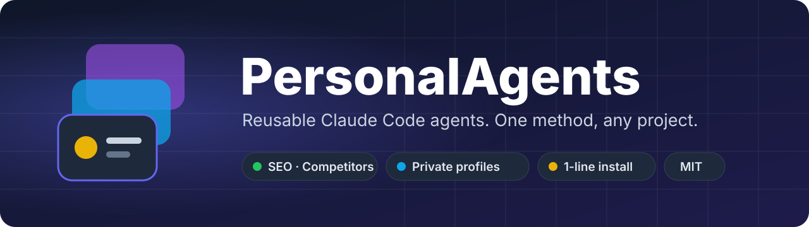
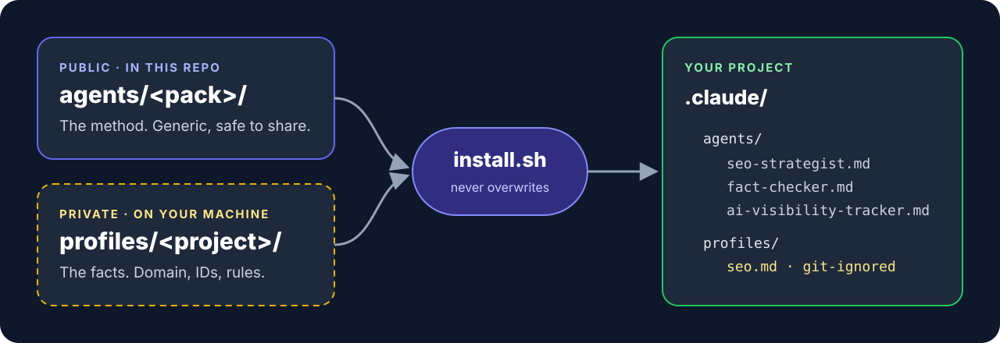
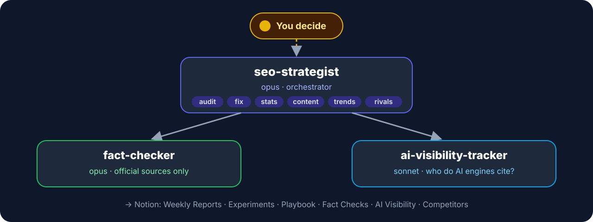

<p align="center">
  
</p>

<p align="center">
  
  
  
  
</p>

<p align="center">
  <a href="#quick-start">Quick start</a> ·
  <a href="#the-seo-team">The SEO team</a> ·
  <a href="#safe-by-design">Safe by design</a> ·
  <a href="#add-your-own-agent">Add your own agent</a> ·
  <a href="#about-the-author">About the author</a>
</p>

---

## The problem

You build a good agent in one project. Then you copy it to the next one, change a few lines, and copy it again.
After a month you have five versions. None of them is the best one, and some of them carry the last project's
Notion IDs, domain and private strategy — sometimes into a public repo.

**PersonalAgents fixes this with one rule: the method and the facts live apart.**

| | Lives in | Shared? |
|:-:|---|---|
| 🧠 **Method** — how to audit, fact-check, measure | `agents/<pack>/` | Yes. Public, generic, the same for every project. |
| 🔒 **Facts** — domain, IDs, sources, rules, target queries | `profiles/<project>/` | No. Git-ignored. Never leaves your machine. |

Improve an agent once, and every project gets the improvement.

## How it works

<p align="center">
  
</p>

Each agent reads `.claude/profiles/<pack>.md` first. **No profile, no work:** the agent stops and says so instead of guessing.

## Quick start

**1. Get the repo**

```bash
git clone https://github.com/farjadp/PersonalAgents && cd PersonalAgents
```

**2. Write a profile for your project** (start from the template, fill every `<…>`)

```bash
mkdir -p profiles/myproject && cp profiles/_template/seo.md profiles/myproject/seo.md
```

**3. Install the pack into your project**

```bash
./install.sh seo ~/path/to/myproject myproject
```

Then, inside the project, ask Claude Code:

> run seo-strategist: stats and audit

Useful extras:

```bash
./install.sh --list
```

- `--force` overwrites files that differ. Without it, nothing is ever overwritten.
- Keep profiles in a private folder instead: `export PERSONAL_AGENTS_PROFILES=~/private/profiles`.
- Or pass a file path as the last argument instead of a name.

## The SEO team

<p align="center">
  
</p>

One team for all four ways people find you today: **SEO** (Google ranking), **AEO** (being *the* answer),
**GEO** (being cited by ChatGPT, Perplexity, Gemini, Claude) and **AIO** (Google AI Overviews).

| | Agent | Model | What it does |
|:-:|---|---|---|
|  | **`seo-strategist`** | opus | The lead. Six jobs — `audit` · `fix` · `stats` · `content` · `trends` · `competitors` — or `all`. Writes a weekly report with evidence for every claim. |
|  | **`fact-checker`** | opus | Checks every figure, date and rule against the **official** source. A blog or an AI answer is a lead, never proof. |
|  | **`ai-visibility-tracker`** | sonnet | Every week, the same queries in the AI answer engines: who do they cite, and is it you? |

<details>
<summary><b>What makes it different from an SEO checklist</b></summary>

- **It learns.** Every change gets a hypothesis and a baseline *before* it ships, is measured at +14 and +28 days,
  and is judged honestly (small changes on small traffic are called *Inconclusive*). Lessons go into a Playbook:
  *Likely* after one experiment, a *Rule* after two.
- **It never invents numbers.** No search volume, position or "AI Overview shows X" that it did not see in this run.
  An auth error is reported as "no access", never as "no data".
- **It writes briefs, not wishes.** Each content brief has the target query, evidence of demand, the direct answer
  the page must open with, the official sources to cite, and the sentence we want AI engines to quote.
- **It watches rivals from data.** A competitor is whoever ranks or is cited on *your* queries — not a list you guess.

</details>

<details>
<summary><b>What you need per project</b></summary>

- A Notion setup: a main SEO page, Weekly Reports, a Playbook, and the Experiments, Fact Checks,
  AI Visibility Tracker and Competitors databases. The profile holds their IDs.
- Search Console access (gcloud application-default credentials).
- Optional: a PageSpeed Insights key, GA4, DataForSEO or Ahrefs.

</details>

## Safe by design

<table>
<tr>
<td width="50%" valign="top">

**The agents**

- 🚫 Never push, merge or deploy. Fixes go on a branch; you decide.
- 👁️ Read-only on outside services: no posting, no settings, no sign-ins, no CAPTCHAs.
- ✋ Never change a fact (a figure, a date, a rule) without your approval.
- 🧾 Text on web pages is *data*. If a page tells the agent to do something, it reports it and does not act.

</td>
<td width="50%" valign="top">

**The repo**

- 🔒 Real profiles are git-ignored. Only the empty template is public.
- 🛡️ `install.sh` never overwrites a file without `--force`.
- 🙈 It also tells the target project's git to ignore `.claude/profiles/`.
- 🔑 No key, password or token in any profile — only the variable name and where it lives.

</td>
</tr>
</table>

Read an agent before you run it. It is a short Markdown file, and it runs with your tools.

## Add your own agent

1. Put the generic agent in `agents/<pack>/<name>.md` (frontmatter: `name`, `description`, `model`, optional `tools`).
2. Move every project fact into your local profile, and add the matching section to `profiles/_template/<pack>.md`.
3. Add it to the tables in this README.

Before you commit, check:

- [ ] No project names, Notion IDs, domains, local paths or secrets in `agents/`.
- [ ] The agent says which profile sections it needs, and stops when the profile is missing.
- [ ] Safety rules (no push, no merge, no deploy, read-only outside) stay in the agent, not the profile.

```
agents/<pack>/          generic agents — public
profiles/_template/     empty profile — public
profiles/<project>/     your real profiles — git-ignored
assets/                 images for this README
install.sh              copies a pack + a profile into a project
```

## Status and roadmap

**Early.** The SEO pack comes from a team built for a live, two-language website in October 2026.
Its first experiments are still being measured, so there are no proven results yet. They will be published here
when there are — failures included.

Next packs: a mobile **UX auditor**, and the product team from
[Divan](https://github.com/farjadp/Divan) (spec, architecture, build, independent review, security, release).

---

## About the author


**Farjad Pourmohammad** is an AI strategist, startup mentor and builder based in Toronto, Canada.
He has spent more than twenty years building technology companies in Iran and Canada — founding and
running a software company, leading engineering teams as a CTO, and building products of his own,
including [Taghvim](https://taghv.im), an open-source Persian calendar, and [Divan](https://github.com/farjadp/Divan),
a product team of AI agents. Today he mentors early-stage founders and helps businesses decide where AI actually
earns its place. PersonalAgents is the toolbox from that work: agents that have done real jobs, kept clean enough
to hand to someone else.

*From complexity, to clarity, to action.*

### Work with me

| | Service | What it is |
|:-:|---|---|
| 🧭 | **AI strategy** | Where AI earns its place in your business — then designing, building and securing it. |
| 🚀 | **Startup mentorship — The Founder Lab** | A free 8-week programme for five teams: customer discovery and lean validation, before you build. |
| 🤝 | **Founder advisory & coaching** | One-to-one sessions: a sparring partner for the decisions only you can make. |
| 🛠️ | **Web, app & AI product development** | Through AshaVid: websites, browser extensions, Android and iPhone apps, widgets and automation. |
| 🔤 | **Persian & right-to-left products** | Correct RTL layout, fonts, Persian digits and Solar Hijri dates, for products with Persian-speaking users. |

<p align="center">
  <b>Start small:</b> a free diagnostic call or a ten-minute self-assessment.<br><br>
  <a href="https://farjadp.info"></a>
</p>

<p align="center">
  🌐 <a href="https://farjadp.info"><b>farjadp.info</b></a> ·
  💼 <a href="https://www.linkedin.com/in/farjadpourmohammad">LinkedIn</a> ·
  ▶️ <a href="https://www.youtube.com/@FarjadTalks">YouTube @FarjadTalks</a> ·
  🐙 <a href="https://github.com/farjadp">GitHub @farjadp</a>
</p>

If these agents save you time, ⭐ **star the repo** and tell me what you built with them.

---

## Licence

MIT — see [LICENSE](LICENSE).

PersonalAgents is an independent project. It is not affiliated with or endorsed by Anthropic.
"Claude" and "Claude Code" are trademarks of Anthropic.
